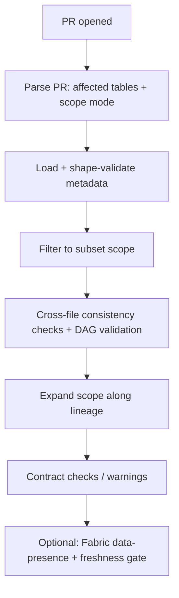

# Architecture

## Overview

Piccolo validates data-platform pull requests against
declarative, metadata-driven contracts before they merge.

## Modules (`src/`)

| Module | Responsibility |
|--------|----------------|
| `constants.py` | Centralized, environment-driven configuration. No hardcoded secrets or IDs. |
| `metadata_parser.py` | Loads and validates the metadata YAML files; provides typed accessors and lineage graph operations. |
| `validate_pr.py` | Parses the PR description and runs the Phase 1 (metadata-only) validation flow. |
| `detect_impact.py` | Maps a git diff to the impacted tables via notebook/pipeline output mappings. |
| `freshness_validator.py` | Execution-freshness gate logic. |
| `fabric_jobs_client.py` | Thin client over the Fabric Jobs / OneLake REST APIs. |
| `trigger_data_presence.py` | Orchestrates the Phase 2 data-presence checks in Fabric. |
| `generate_lineage.py`, `generate_registry.py` | Helpers to scaffold metadata from notebook source. |

## Validation flow (high level)

## Design principles

- **Metadata over code** — checks are declared as YAML data.
- **No hardcoded environment** — all paths and IDs come from env vars / CLI.
- **Offline-testable** — the core engine has no cloud dependency.

## Phase 2: Fabric data-presence checks

Phase 1 (everything above) is offline. **Phase 2** runs the live data-quality
checks against a Microsoft Fabric lakehouse via the Jobs API. The notebook that
executes those checks ships in [`../fabric/`](../fabric/), together with its
`tables_json` input and results-JSON output contract. Phase 2 is optional — the
engine and its full test suite run without it.
